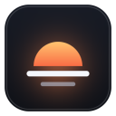
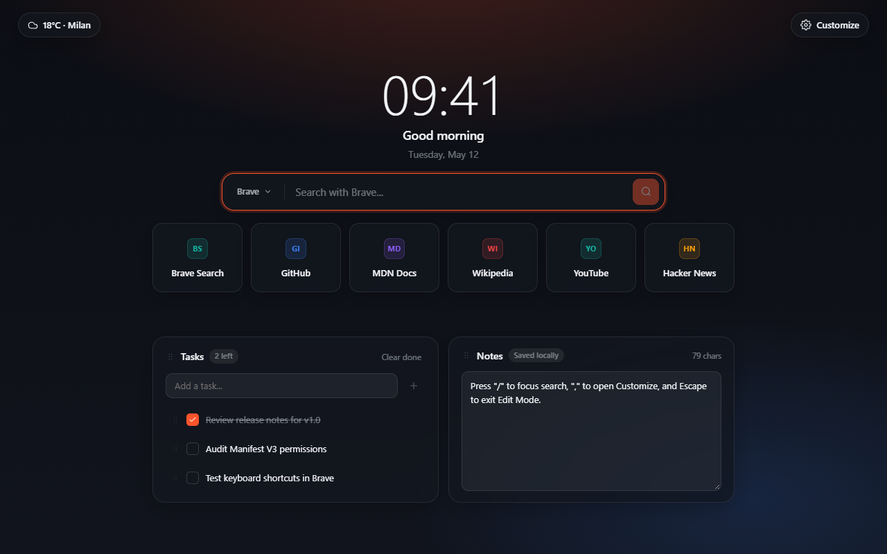
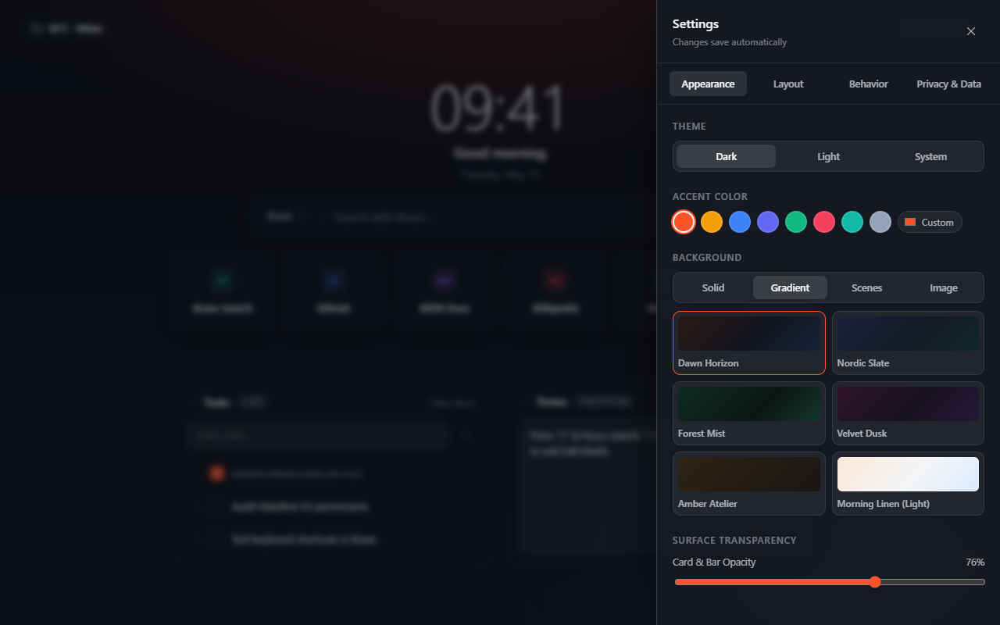
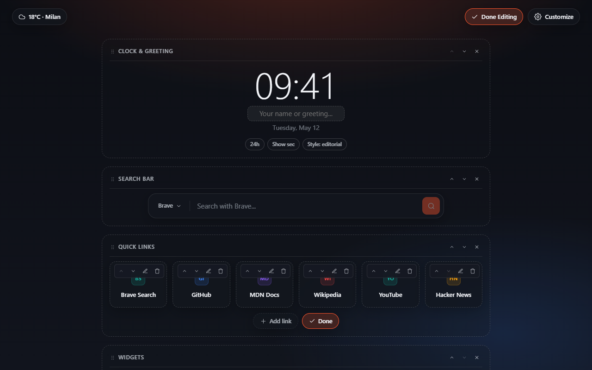
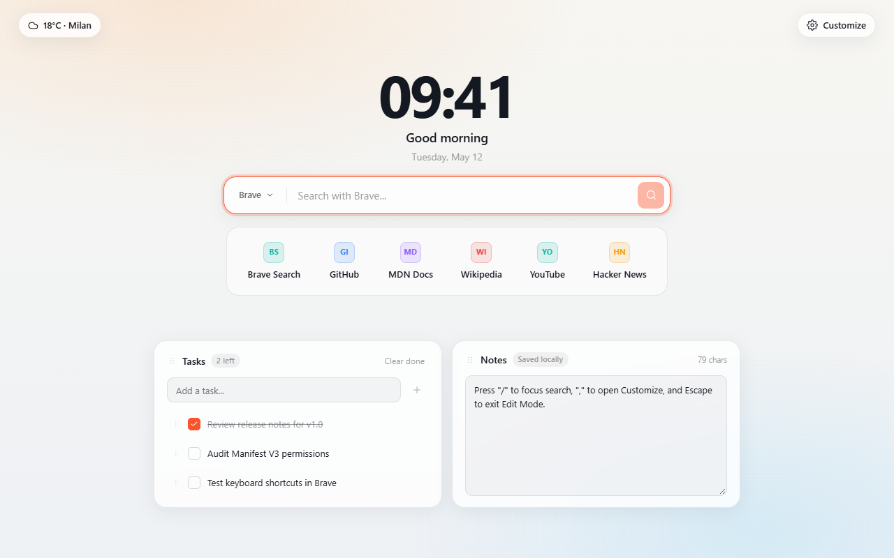
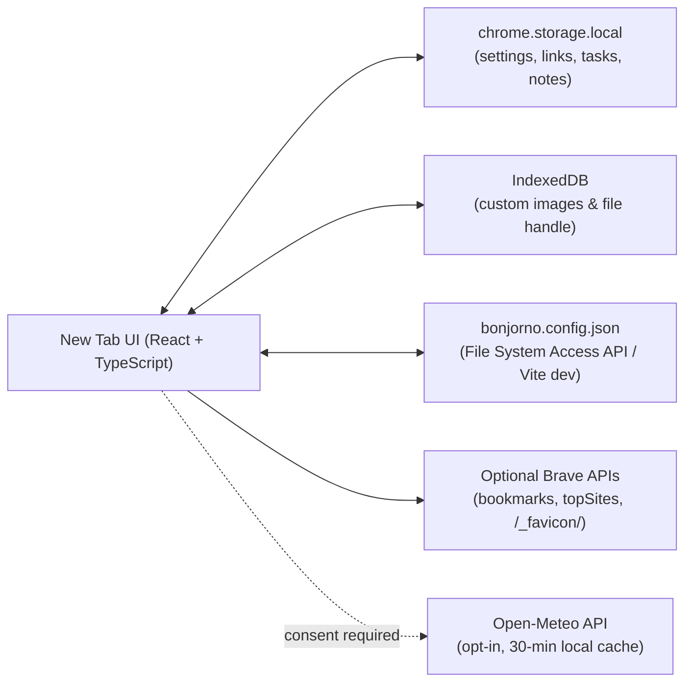

<div align="center">
  
  <h1>Bonjorno</h1>
  <p>A calm, fast, privacy-first Manifest V3 New Tab dashboard for Brave Browser.</p>

  <p>
    <a href="https://github.com/projectGloria/Bonjorno/actions/workflows/ci.yml"></a>
    
    
    
    
    
  </p>
</div>

<p align="center">
  
</p>

<p align="center">
  <a href="#features">Features</a> ·
  <a href="#screenshots">Screenshots</a> ·
  <a href="#how-it-works">How it works</a> ·
  <a href="#installation">Installation</a> ·
  <a href="#usage">Usage</a> ·
  <a href="#building-from-source">Building from source</a> ·
  <a href="#permissions">Permissions</a> ·
  <a href="#contributing">Contributing</a>
</p>

## About

**Bonjorno** replaces Brave Browser's default New Tab page with a customizable dashboard that runs entirely locally—no account, no subscription, no analytics, and no remote backend. All settings, shortcuts, tasks, and notes stay in your browser (`chrome.storage.local`) and can optionally sync to a portable `bonjorno.config.json` file in your repository root.

## Features

- **Clock, Date & Greeting**: Tabular-numeral clock with 12/24-hour modes, optional seconds, four typography styles (`Editorial`, `Display`, `Monospace`, `Minimal`), four date formats (`Long`, `Short`, `Numeric`, `ISO`), and an automatic time-of-day or custom greeting.
- **Multi-Engine Search Bar**: Defaults to Brave Search with one-click switching between Brave Search, DuckDuckGo, Google, Startpage, Kagi, Perplexity, GitHub, Wikipedia, YouTube, and custom `%s` search templates. Detects direct URLs automatically and supports `/` to focus from anywhere.
- **Quick Links & Optional Brave Integrations**: Add, edit, delete, and reorder shortcuts via drag-and-drop or keyboard controls across four layouts (`Grid` 4–8 columns, `Chips`, `Dock`, `List`). Uses Chromium's local MV3 `/_favicon/` cache with monogram fallbacks, plus opt-in **Bookmarks** drawer and **Most Visited Sites** bar.
- **Local Widgets & Opt-In Weather**: Built-in **Tasks** checklist and **Notes** scratchpad persisted locally. An optional **Weather** pill (disabled by default) queries [Open-Meteo](https://open-meteo.com/) only after explicit user consent and caches results locally for 30 minutes.
- **Visual Customization & Edit Mode**: Dark, Light, and System themes; 8 accent presets plus custom hex picker; Solid colors, 6 ambient Gradients, 4 procedural SVG Scenes, or local Custom Background Images (optimized and stored in IndexedDB) with fit, position, blur, dim, and surface opacity controls. Toggle **Edit Mode** to drag-reorder or hide dashboard sections directly.
- **Portable Local Config (`bonjorno.config.json`)**: Automatically loads settings bundled into `dist/bonjorno.config.json` on fresh installs or newer timestamps, auto-saves to disk via the File System Access API in Brave (or Vite dev middleware during development), and supports schema-validated JSON export/import.

## Screenshots

<p align="center">
  
  <br /><em>Customize Drawer: live theme, accent color, background, and surface transparency controls.</em>
</p>

<p align="center">
  
  <br /><em>Edit Mode: reorder or hide dashboard sections and adjust clock, greeting, and shortcuts inline.</em>
</p>

<p align="center">
  
  <br /><em>Light Theme: Morning Linen gradient, Display clock typography, and Dock quick-links layout.</em>
</p>

## How it works



On startup, Bonjorno reads `chrome.storage.local` alongside the bundled `bonjorno.config.json` and merges whichever is newer through a schema sanitizer (`src/services/settingsStorage.ts`). Uploaded wallpapers are resized and stored as blobs in IndexedDB (`src/services/imageStore.ts`), while optional browser APIs and weather lookups remain inactive unless you explicitly turn them on.

## Installation

### Load unpacked in Brave Browser

1. Clone the repository and build the extension (or extract `release/bonjorno-extension.zip` to a permanent folder):
   ```bash
   git clone https://github.com/projectGloria/Bonjorno.git
   cd Bonjorno
   npm install
   npm run build
   ```
2. Open Brave Browser and go to `brave://extensions`.
3. Enable **Developer mode** in the top-right corner.
4. Click **Load unpacked** and select the `dist/` directory (or the extracted ZIP folder).
5. Open a new tab (`Ctrl+T` / `Cmd+T`) to launch Bonjorno.

## Usage

### Keyboard shortcuts

| Shortcut | Action |
| --- | --- |
| `/` | Focus the search bar from anywhere on the page |
| `,` | Open or close the **Customize** drawer |
| `Escape` | Clear search input, close drawers, or exit **Edit Mode** |

### Syncing settings with `bonjorno.config.json`

To keep your shortcuts, theme, layout, tasks, and notes portable across machines:

- **In Brave (installed extension)**: Open **Customize → Privacy & Data → Local Repo Sync**, click **Link `bonjorno.config.json`**, and select the file in your repo root. Subsequent edits auto-save directly to disk via the File System Access API.
- **In dev mode (`npm run dev`)**: Changes automatically save to `bonjorno.config.json` through the local Vite middleware (`/__bonjorno/config`).
- **On a new machine**: Running `npm run build` bundles `bonjorno.config.json` into `dist/bonjorno.config.json`, which Bonjorno loads automatically on first launch or whenever the file timestamp is newer than local storage.

## Building from source

### Prerequisites

- **Node.js 20+** and **npm**

### Commands

1. Install dependencies:
   ```bash
   npm install
   ```
2. Run the local dev server:
   ```bash
   npm run dev
   ```
3. Run the Vitest unit test suite:
   ```bash
   npm test
   ```
4. Generate PNG icons, type-check, and build the production extension into `dist/`:
   ```bash
   npm run build
   ```
5. Build and package a distributable ZIP at `release/bonjorno-extension.zip`:
   ```bash
   npm run package
   ```

## Permissions

Bonjorno follows the principle of least privilege. No analytics, telemetry, ads, or external tracking scripts are included.

| Permission | Type | Purpose |
| --- | --- | --- |
| `storage` | Required | Persists settings, quick links, tasks, notes, and weather cache in `chrome.storage.local`. |
| `favicon` | Required | Reads locally cached site favicons via Chromium's `/_favicon/` API without external requests. |
| `bookmarks` | Optional | Requested only when you enable the **Bookmarks** drawer to browse and search Brave bookmarks locally. |
| `topSites` | Optional | Requested only when you enable **Most Visited Sites** to display frequently visited pages locally. |

<details>
<summary>Project structure</summary>

```text
Bonjorno/
├── public/
│   ├── manifest.json           # Manifest V3 extension manifest
│   └── icons/                  # Generated 16/32/48/128 PNG icons
├── scripts/
│   ├── generate-icons.mjs      # Pure-Node PNG icon generator
│   └── package-zip.mjs         # Packages dist/ into release/bonjorno-extension.zip
├── src/
│   ├── components/             # Dashboard sections, drawers, and widgets
│   ├── constants/              # Defaults, search engines, gradients, and SVG scenes
│   ├── hooks/                  # Reactive settings and drift-free clock hooks
│   ├── services/               # chromeApi, settingsStorage, localConfigSync, imageStore, weather
│   ├── styles/                 # Design tokens, global styles, component styles
│   ├── types/                  # Strict TypeScript interfaces
│   └── utils/                  # URL validation/search builders and time formatting
├── tests/                      # Vitest unit tests (settingsStorage, time, url)
├── bonjorno.config.json        # Portable local configuration file
├── dist/                       # Production extension output
└── release/                    # Packaged bonjorno-extension.zip
```

</details>

## Contributing

Contributions are welcome. Before opening a pull request on [projectGloria/Bonjorno](https://github.com/projectGloria/Bonjorno):

1. Run `npm test` and ensure all unit tests pass.
2. Run `npm run build` to verify TypeScript type-checking and the production extension bundle.
3. Avoid committing personal shortcuts or names in `bonjorno.config.json`.

## License

<!-- TODO: add a LICENSE file to the repository and update this section. -->
No license file is currently included in this repository.
